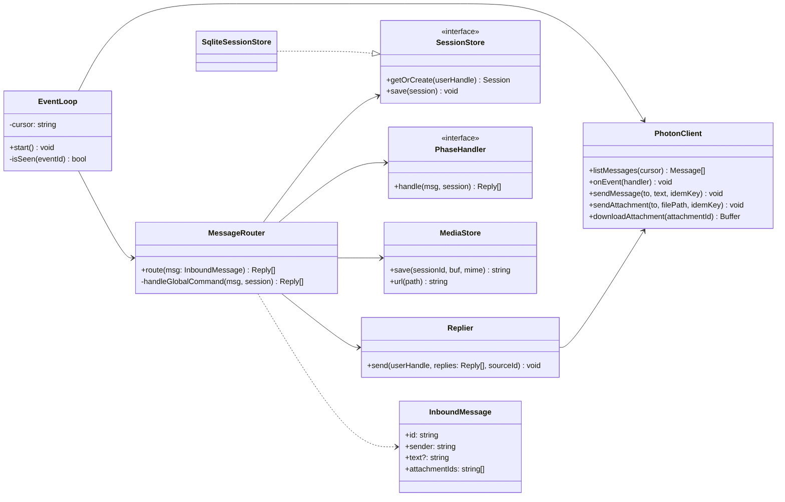
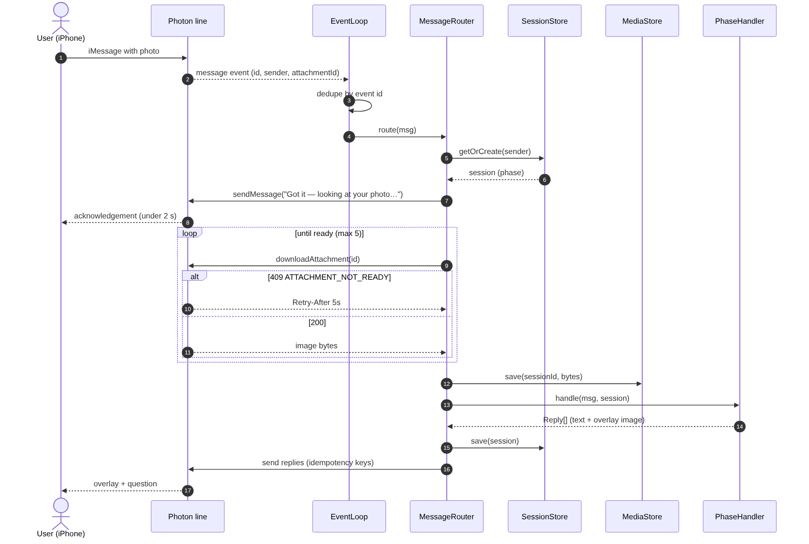

# Feature Design: iMessage Gateway

## Related Requirements
FR-GW-01 … FR-GW-07, NFR-GW-01 … NFR-GW-04

## UML Diagrams

### Class Diagram

### Sequence Diagram: inbound photo

Sources: `diagrams/*.mmd` (Mermaid). Regenerate PNGs with `npx -p @mermaid-js/mermaid-cli mmdc -i x.mmd -o x.png`.

## Design Notes
- **Main classes or components:** `PhotonClient`, `EventLoop`, `MessageRouter`, `SessionStore` (interface) / `SqliteSessionStore`, `MediaStore`, `Replier`.
- **Responsibilities:**
  - `PhotonClient` wraps the beta API: `listMessages`, live events, `sendMessage`, `sendAttachment`, `downloadAttachment` (with 409 retry).
  - `EventLoop` pulls events, dedupes against `events_seen`, and hands each new message to the router. It persists the replay cursor.
  - `MessageRouter` normalizes the sender, loads the session, checks global commands, then dispatches by `session.phase` to the handlers from features 02–06.
  - `Replier` adds idempotency keys, masks logs, and sends text or image replies.
  - `MediaStore` saves downloads to `data/media/<sessionId>/` and serves them at `/media/:file` for the plan page.
- **Important interactions:** The router acknowledges immediately (NFR-GW-01), then awaits the handler. Handlers return `Reply[]`, so all sending stays in one place and is easy to test.
- **Assumptions:** The shared line delivers inbound attachments in beta (confirm in Phase 0; otherwise FR-GW-05). One user = one active session. The user always messages first.
