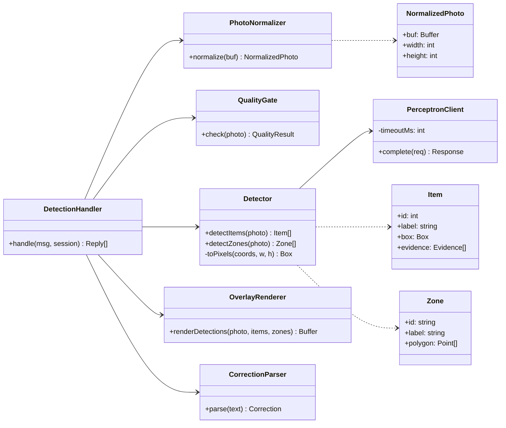
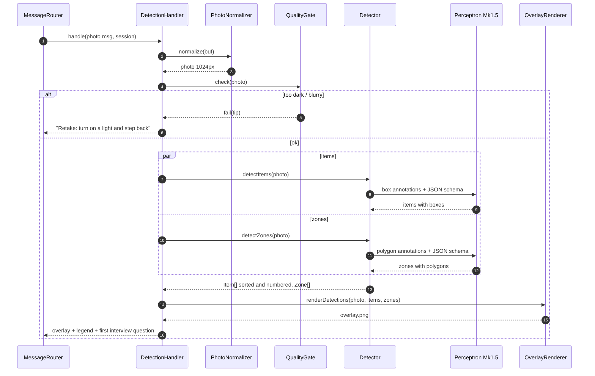

# Feature Design: Item & Storage Detection

## Related Requirements
FR-DET-01 … FR-DET-07, NFR-DET-01 … NFR-DET-03

## UML Diagrams

### Class Diagram

### Sequence Diagram: photo → overlay

## Design Notes
- **Main classes or components:** `PhotoNormalizer`, `QualityGate`, `PerceptronClient`, `Detector`, `OverlayRenderer`, `CorrectionParser`, `DetectionHandler` (a `PhaseHandler` for `awaiting_photo`).
- **Responsibilities:**
  - `PhotoNormalizer` uses sharp: rotate, resize, re-encode. It returns the buffer + dimensions so every box uses one coordinate space.
  - `QualityGate` runs cheap local checks (luminance, blur) before spending a model call.
  - `PerceptronClient` makes a typed `chat.completions` call to `perceptron-mk1.5`, with timeout, one retry, and latency logging.
  - `Detector` builds prompts, runs **items** and **zones** calls in parallel (`Promise.all`), validates with zod, converts coordinates to pixels if the API returns normalized values, and sorts and numbers the results.
  - `OverlayRenderer` builds an SVG (rects, circles with numbers, dashed zone polygons) and composites it with sharp. Labels are ≥ 28 px so they're readable on a phone.
  - `CorrectionParser` uses regex first, then falls back to Gemini for odd phrasing.
- **Important interactions:** The item prompt includes `LABEL_VOCAB` (charger, cable, phone, notebook, pen, mug, headphones, receipt/paper, book, keys, wallet, water bottle, snack, other) to keep labels consistent across before/after photos, which feature 06 relies on.
- **Assumptions:** Perceptron's box coordinate system (pixel vs. 0–1000 normalized) is confirmed in Phase 0 and handled in one function `toPixels()`. Two separate calls (items, zones) are more reliable than one mixed call.
