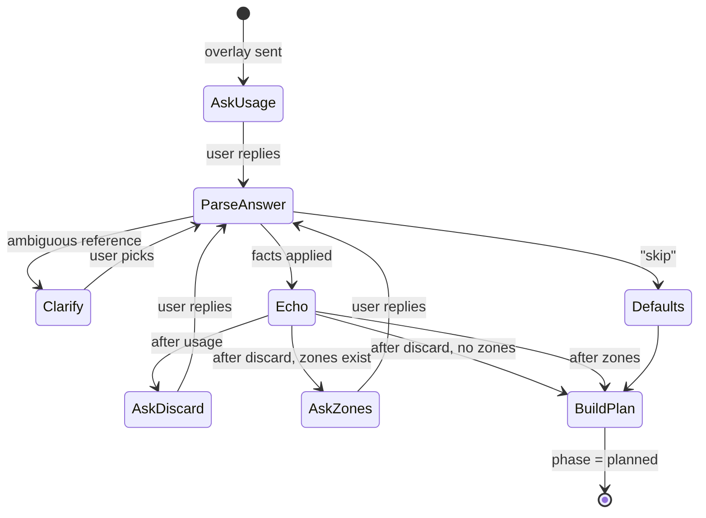
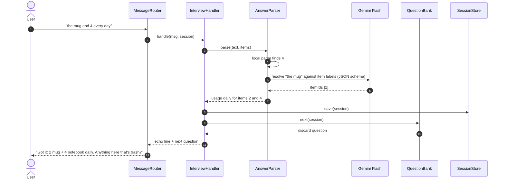

# Feature Design: Context Interview

## Related Requirements
FR-INT-01 … FR-INT-05, NFR-INT-01, NFR-INT-02

## UML Diagrams

### Activity Diagram: interview flow

### Sequence Diagram: one answer

## Design Notes
- **Main classes or components:** `InterviewHandler` (a `PhaseHandler` for `interview`), `QuestionBank`, `AnswerParser`, `GeminiClient` (shared).
- **Responsibilities:**
  - `QuestionBank` decides the next question from session state (skips the zone question if there are no zones).
  - `AnswerParser` does a fast local parse first (digits, ranges, `none`, `skip`). It calls Gemini only when the answer contains words that need to be matched to labels. Its output is validated with zod.
  - `InterviewHandler` applies the parsed facts to `session.items` / `session.zones`, sends the echo line, and either asks the next question or switches to `planned` (calling feature 04).
- **Important interactions:** Corrections from feature 02 (`3 is a power bank`) are also accepted during this phase. The router checks the correction regex before the answer parser runs.
- **Assumptions:** Users answer in English and in short form. Three questions is the most people tolerate before they want the plan.
