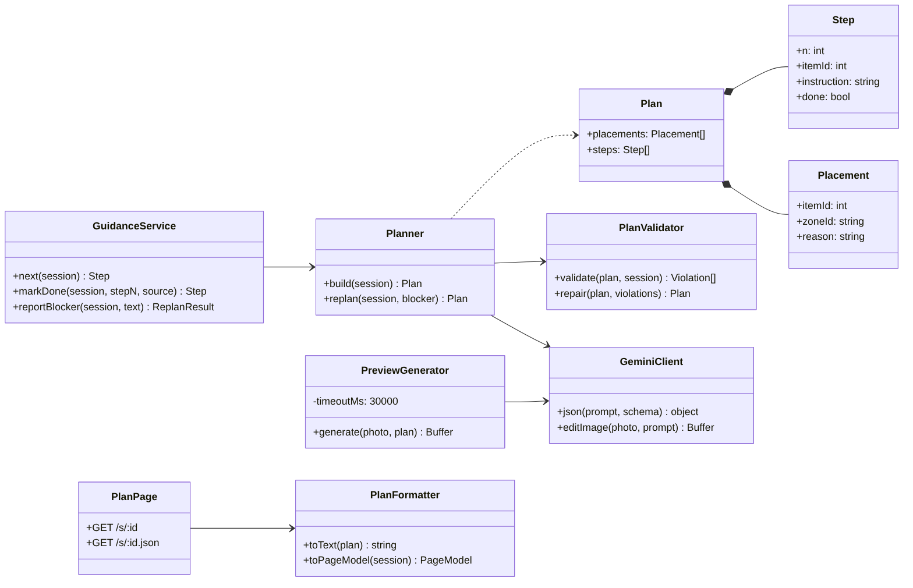
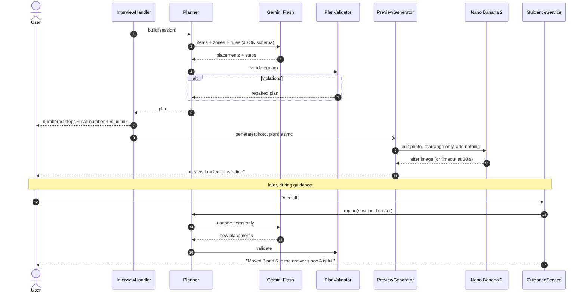

# Feature Design: Organization Plan

## Related Requirements
FR-PLAN-01 … FR-PLAN-07, NFR-PLAN-01 … NFR-PLAN-03

## UML Diagrams

### Class Diagram

### Sequence Diagram: plan + preview + re-plan

## Design Notes
- **Main classes or components:** `Planner`, `PlanValidator`, `PreviewGenerator`, `PlanFormatter`, `GuidanceService`, `PlanPage` (Hono route + HTML template).
- **Responsibilities:**
  - `Planner.build(session)` sends a Gemini prompt with items (id, label, usage, discard), zones (id, label, full), and the rules. It returns `Placement[]` + `Step[]`.
  - `PlanValidator` checks rules (a)–(e). It repairs what it can deterministically (e.g., moves an item out of a full zone to `desk_keep`), and regenerates once if more than 2 violations are found.
  - `GuidanceService` is the **single source of truth** for `next()`, `markDone()`, `reportBlocker()`, and `replan()`. It's used by text commands here and by the voice tools in feature 05, so the channels can't drift apart.
  - `PreviewGenerator` makes a fire-and-forget Nano Banana 2 call with a 30 s timeout. It stores `session.previewImage` and sends it when ready.
  - `PlanFormatter` builds the iMessage step list and the plan page view model.
  - `PlanPage` is server-rendered HTML using the overlay plus destination letters drawn by `OverlayRenderer`. A 5 s `fetch` poll of `/s/:id.json` keeps checkboxes current during the demo.
- **Important interactions:** `replan()` keeps completed steps fixed and only re-plans undone items, which keeps the user's progress stable.
- **Assumptions:** Zones from feature 02 exist. If none were detected, the planner uses the generic zones `desk_keep`, `drawer`, and `bin`, and says so.
