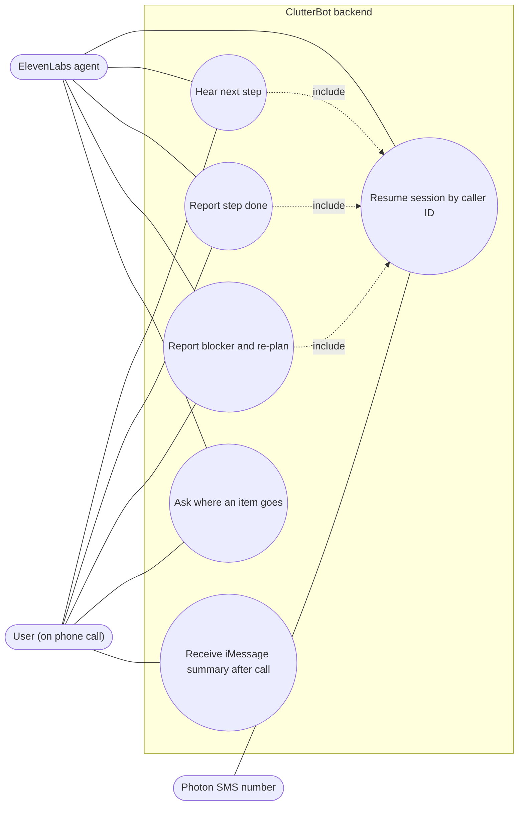
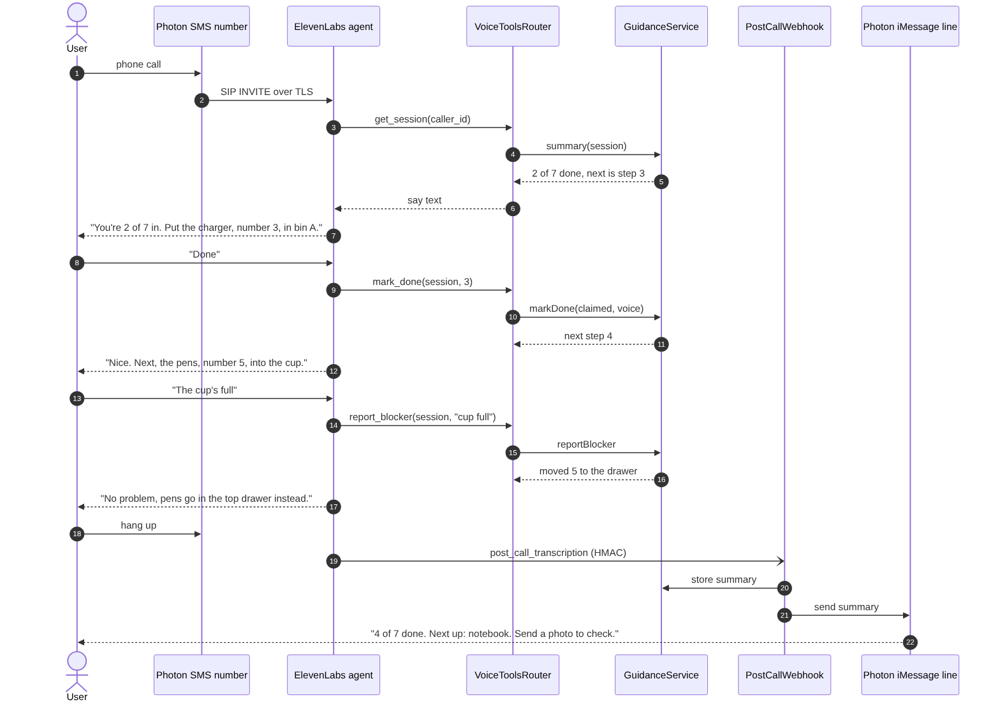

# Feature Design: Voice Guidance

## Related Requirements
FR-VOICE-01 … FR-VOICE-06, NFR-VOICE-01 … NFR-VOICE-03

## UML Diagrams

### Use Case Diagram

### Sequence Diagram: call → tools → text hand-off

## Design Notes
- **Main classes or components:** ElevenLabs agent (configured in their dashboard: system prompt, voice, tools), `VoiceToolsRouter` (Hono routes `/tools/*`), `ToolAuth` middleware, `PostCallWebhook` (`/hooks/elevenlabs`), `GuidanceService` (from feature 04), `Replier` (from feature 01).
- **Responsibilities:**
  - `VoiceToolsRouter` translates tool calls into `GuidanceService` calls and returns short, speakable strings (`say` field) + structured data.
  - `ToolAuth` checks `x-clutterbot-secret` on every tool request.
  - `PostCallWebhook` verifies the `ElevenLabs-Signature` HMAC, finds the session by caller number (or by the `session_id` dynamic variable set by `get_session`), stores the summary, and sends the iMessage hand-off via `Replier`.
- **Important interactions:** The phone number on the call (SMS line) differs from the iMessage line. The **caller's** number is the key that joins them to one session. Normalize to E.164 in both places.
- **Agent system prompt (summary):** You're ClutterBot, a calm organizing coach. Call `get_session` first. Give exactly one action per turn. Use item names + numbers. Never say an item is verified; suggest a photo instead. If the user is stuck, call `report_blocker`. Keep turns under 2 sentences.
- **Assumptions:** The ElevenLabs caller-ID variable is populated for SIP-imported numbers. If it isn't, fall back to asking the user for the last 4 digits of their phone, then match. The cloudflared tunnel URL is stable for the demo.
