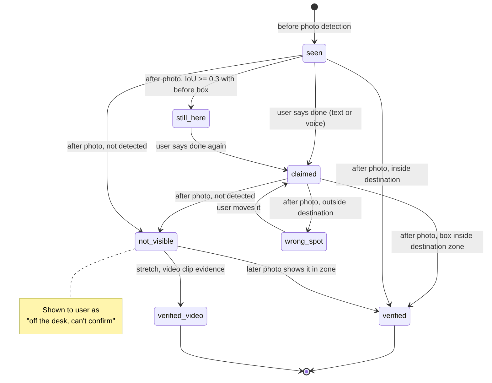
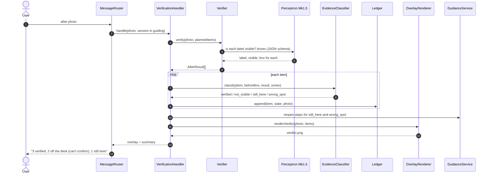

# Feature Design: Photo Verification & Evidence Ledger

## Related Requirements
FR-VER-01 … FR-VER-06, NFR-VER-01 … NFR-VER-03

## UML Diagrams

### State Diagram: evidence for one item

### Sequence Diagram: after photo → verdict

## Design Notes
- **Main classes or components:** `VerificationHandler` (a `PhaseHandler`), `Verifier`, `EvidenceClassifier`, `Ledger`, `OverlayRenderer.renderVerdict`, `VerdictFormatter`.
- **Responsibilities:**
  - `Verifier` runs a targeted Perceptron query ("for each of these labels, is it visible? box if yes"). This is more reliable than open re-detection followed by matching. It also handles zone reuse versus re-detection.
  - `EvidenceClassifier` is a **pure function** `(item, beforeBox, afterResult, zones) → EvidenceState`, using point-in-polygon and IoU. Pure means it's unit-testable on fixtures, and it's where NFR-VER-02 is enforced.
  - `Ledger` holds append-only evidence entries per item. `latest(item, source)` returns the most recent photo state and the most recent user claim separately.
  - `VerdictFormatter` builds the wording rules for NFR-VER-03: "verified" only from photo evidence, and "can't confirm" for `not_visible`.
- **Important interactions:** `GuidanceService` (feature 04) reads the ledger, so a `still_here` item re-opens its step, and voice (feature 05) can say "the photo still shows the mug on the desk."
- **Why this matters:** This is ClutterBot's distinguishing mechanism. It keeps what the user *says* separate from what the camera *sees*, which answers Photon's "safety and recovery" criterion and Perceptron's "creative use of perception."
- **Assumptions:** The after photo is taken from roughly the same spot as the before photo (we prompt: "same angle as before"). Open bins make placement visible. A closed drawer is honestly reported as unconfirmed.
- **Stretch (cut first):** a short iMessage video of putting an item away, sent to Perceptron with `annotation_format: "clip"` to find the moment the item enters the drawer. That would upgrade `not_visible` → `verified (video)`.
