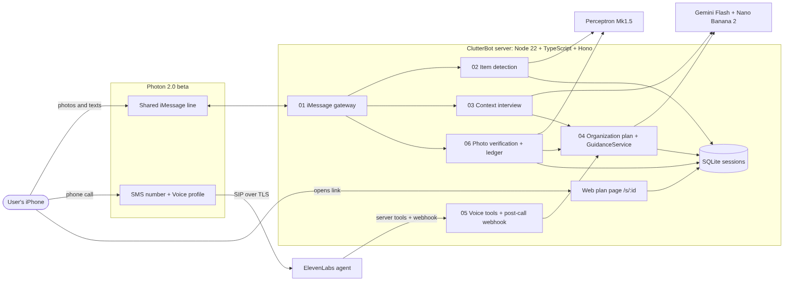

# Technology Stack



## Frontend
- **iMessage (via Photon 2.0 beta)** is the primary interface. Users text photos and answers, and receive annotated images and steps. No app install, and it fits Photon's track requirement that the agent be live on a real channel.
- **Phone call (via Photon SMS number → ElevenLabs Agents)** is the hands-free interface while the user is physically cleaning.
- **Web plan page `/s/:id`**: server-rendered HTML + a small vanilla TypeScript bundle + hand-written CSS. It's read-only: annotated photo, item → place list, progress, illustrative preview. It's linked from iMessage. No framework, because it's a single page, it has to load fast on a phone, and it carries 20% of the design score.

## Backend
- **Node.js 22 + TypeScript**, run with `tsx` in dev. The Photon API client, ElevenLabs webhooks, and image tooling all have first-class JS support, and it's one language for server and page.
- **Hono** HTTP server: small, typed routes for `/tools/*` (ElevenLabs server tools), `/hooks/elevenlabs` (post-call webhook), `/s/:id` (plan page), and `/media/:file`.
- **Photon 2.0 beta API client**: list/receive messages (live events with replay cursor; polling `listMessages` as fallback), `sendMessage` with idempotency keys, and attachment download (handle `ATTACHMENT_NOT_READY` 409 + `Retry-After`).
- **Perceptron Mk1.5** (`perceptron-mk1.5`) over HTTPS chat completions (`https://api.perceptron.inc/v1/chat/completions`; confirm with the Perceptron team). `annotation_format: "box"` / `"polygon"`, a JSON Schema response, and `reasoning_effort: "low"` or `"none"` for latency.
- **Google Gemini** via `@google/genai`:
  - Gemini Flash text model with JSON-schema output to parse answers, build the plan, and re-plan.
  - **Nano Banana 2 (Gemini 3.1 Flash Image)** to edit the real photo into an illustrative "after" preview. Confirm the exact model ID in AI Studio.
- **ElevenLabs Agents**: voice conversation, SIP inbound from Photon (`sips:sip.rtc.elevenlabs.io:5061`, TLS), server tools calling our backend, and a post-call transcription webhook (HMAC verified).
- **sharp**: resize/crop input photos, and composite SVG overlays (numbered boxes, zone outlines, green/amber/red verdicts) onto photos.
- **zod**: validate every model response and webhook body before it touches the session.

## Database
- **SQLite via `better-sqlite3`**, one file `data/clutterbot.db`. Tables: `sessions` (JSON document per session, keyed by user handle), `events_seen` (dedupe of Photon event IDs), `media` (file paths). It's synchronous, needs zero setup, and survives restarts mid-demo.
- **Optional:** MongoDB Atlas (free tier) for the `sessions` collection, only if set up in ≤ 15 minutes, for the MLH Atlas prize. `SessionStore` is an interface so the swap is a single class.

## Testing
- **Vitest** for unit tests: answer parser, plan validator, ledger state transitions, overlay geometry, item matching.
- **Recorded fixtures** in `test/fixtures/`: 3 tray photos (messy, half-done, done), plus saved Perceptron and Gemini JSON responses, so tests run offline and fast.
- **Manual end-to-end test cases** in each feature's `validation.md`, run on a real iPhone and a real phone call.
- **VEYZL** PR audits as the review gate on every merge to `main`.
- **Latency log**: each external call is timed and written to stdout as `[latency] perceptron.detect 2140ms`.

## Constraints
- Node.js ≥ 22, TypeScript ≥ 5.5, ES modules.
- Photon **2.0 beta**, with a **shared iMessage line**: the user must message first, no group chats, no calls on that line. Voice uses a **separate SMS number**.
- Perceptron Isaac 0.1/0.2 are retired. Use **Mk1.5 only**.
- Public HTTPS URL required for ElevenLabs tools/webhooks: `cloudflared` tunnel from the laptop (optional: deploy to a VM).
- Secrets only in `.env` (git-ignored). Never log API keys or full phone numbers (mask to last 4).
- **DubHacks rules:** ≥ 70% of code written during the hackathon window (started Sat 12:30 pm), public GitHub repo, and a video in the final submission.
- Image size sent to models: longest side ≤ 1024 px. Photos are deleted when the session ends.
- One active session per user handle.

## Shared Conventions
Every feature reads and writes one `Session` document:

```ts
type EvidenceState = "seen" | "claimed" | "verified" | "not_visible" | "still_here";

interface Item {
  id: number;                 // 1-based, matches the number drawn on the overlay
  label: string;              // from LABEL_VOCAB, e.g. "phone charger"
  box: [number, number, number, number];   // x1,y1,x2,y2 in pixels of the normalized photo
  destinationZoneId?: string;
  reason?: string;
  usage?: "daily" | "sometimes" | "rarely";
  discard?: boolean;
  evidence: { state: EvidenceState; at: string; source: "photo" | "user_text" | "voice" }[];
}

interface Zone { id: string; label: string; polygon: [number, number][]; full?: boolean; }

interface Step { n: number; itemId: number; instruction: string; done: boolean; }

interface Session {
  id: string;                  // short slug used in /s/:id
  userHandle: string;          // iMessage sender, normalized E.164 or Apple ID email
  phase: "awaiting_photo" | "interview" | "planned" | "guiding" | "verifying" | "complete";
  beforePhoto?: string; afterPhotos: string[];
  items: Item[]; zones: Zone[];
  interview: { q: string; a?: string }[];
  steps: Step[]; previewImage?: string;
  createdAt: string; updatedAt: string;
}
```

Requirement IDs are prefixed per feature: `GW` gateway, `DET` detection, `INT` interview, `PLAN` plan, `VOICE` voice, `VER` verification.
